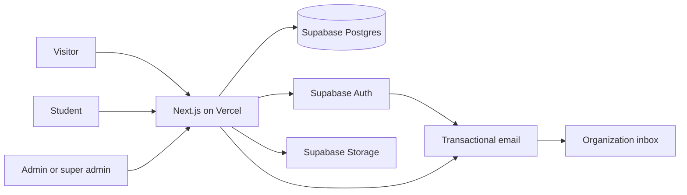
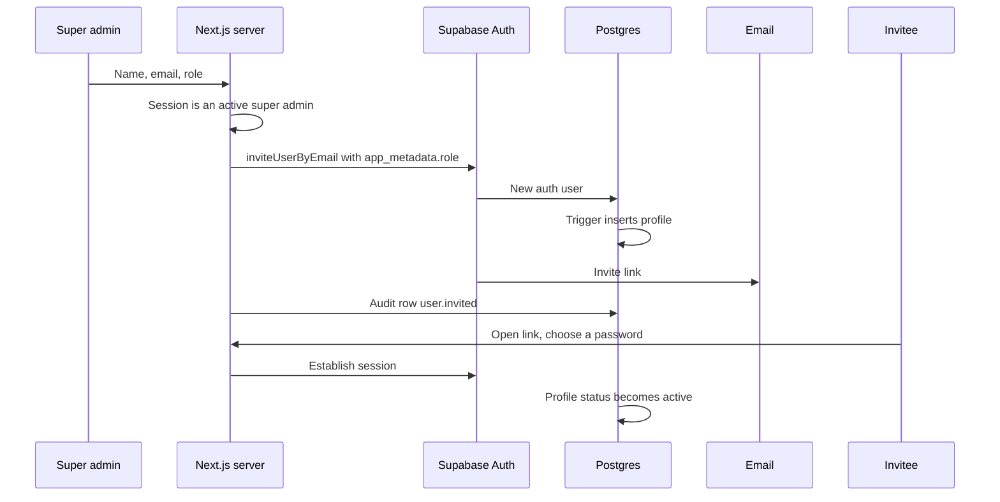

# System architecture

## Context



Railway is not in this picture. The condition for adding it is in [ADR 002](adr/002-server-boundary-and-railway.md).

## Runtime responsibilities

| Piece | Responsibility |
| --- | --- |
| Browser | Render the UI, hold the auth session cookies, upload a cover through a path the server authorizes |
| Next.js Server Components | Render public pages and staff pages, read Postgres with the appropriate key |
| Next.js Server Actions and route handlers | Validate input, perform privileged writes, revalidate cached pages, run cron |
| Supabase Auth | Passwords, invite links, password reset, sessions, MFA factors |
| Postgres | Listings, profiles, inquiries, audit, RLS |
| Storage | Public cover images. A private bucket is reserved for a later application-file design and is not created until then |
| Email provider | Auth mail (invite, reset, email change) and staff notification of a new contact message |
| Vercel | Hosting, TLS, preview deployments, cron, logs |
| Vercel Analytics or a privacy-oriented product | Optional, off until cookies are accepted. See [D-13](07-gaps-and-decisions.md) |

## Request paths

### Read a published listing

1. The visitor requests `/scholarships/[slug]`.
2. A Server Component queries Postgres with the anon key.
3. RLS returns the row only when the status is `published` or `closed`.
4. The page is cached under the tag `scholarships`.
5. Archived and unknown slugs return 404. Drafts return 404 on the public route.

### Save a listing

1. The staff session calls a Server Action.
2. The server builds a Supabase client with that user’s cookies, not the service role.
3. Zod validates the payload. Markdown is stored as markdown and sanitized at render time.
4. RLS allows the write only for an active staff profile.
5. A database trigger writes the audit row and enforces publish rules.
6. The action calls `revalidateTag('scholarships')` so the public page updates without waiting for a timer.
7. Preview uses the same public components and a staff-only query by id.

Using the user session for these writes means a bug in a Server Action still cannot bypass RLS.

### Invite a user



The role is written to `app_metadata` by the Auth admin API. It is not taken from a value the invitee can edit. Profile role changes after that go through the super-admin route, which also updates `app_metadata`, so the two stay aligned.

### Contact form

1. The visitor submits the form.
2. A route handler rejects the honeypot, validates fields, and checks a short-lived rate-limit row.
3. The service role inserts the message.
4. The handler emails the organization inbox.
5. If the email send fails, the message stays stored and the visitor still sees success. Staff can read it in the inbox. The failure is logged without the message body.

Anon has no insert grant on contact messages, so the form cannot be pointed straight at the database from a script using the public key.

### Close expired listings

Once a day, Vercel Cron calls `POST /api/cron/close-scholarships` with `Authorization: Bearer ${CRON_SECRET}`.

The handler, using the service role, calls `close_expired_scholarships()`. That function closes published listings whose deadline has passed and that are not rolling. The status trigger sets `closed_at`, clears `is_featured`, and writes the audit row with `actor_id` null and `metadata.source = cron`. The same route can call `purge_rate_limit_buckets()`.

Rolling listings are left alone.

## Caching

| Data | Cache |
| --- | --- |
| Published catalog and detail | Tagged `scholarships`, revalidated on staff mutation and after cron |
| Static marketing pages | Default static rendering, new copy ships on deploy |
| Admin pages and account | Dynamic, per session |
| Auth callbacks | Dynamic |

Cron also calls `revalidateTag('scholarships')` after it closes rows, otherwise a closed program could remain on the cached home page until the next edit.

## Authorization layers

Defense is layered on purpose.

| Layer | What it stops |
| --- | --- |
| Route and Server Action checks | A student calling an admin action gets a clean refusal before any write |
| Zod schemas shared by the form and the server | Unexpected shapes and over-long fields |
| RLS | A stolen anon key, a buggy query, or a crafted client cannot read drafts or change roles |
| Column split | Internal notes live in a second table students cannot select |
| Triggers | Illegal status jumps, self-promotion, publishing without the checklist |
| Dashboard settings | Public sign-up disabled, so the “default role student” path is not exposed as registration |

Details and the policy matrix are in [05-auth-and-authorization.md](05-auth-and-authorization.md).

## Rendering and XSS

Listing body fields are markdown. Render them with a markdown renderer configured to allow a small set of elements (paragraphs, lists, links, emphasis, headings) and to strip raw HTML, scripts, and javascript URLs. Links from markdown use `rel="noopener noreferrer"`.

Do not store pre-rendered HTML from the browser as the source of truth.

## Files

Bucket `scholarship-media` is public-read so cover images and social crawlers can fetch them without a signed URL.

Object path: `scholarships/{scholarship_id}/cover.{ext}`

Uploads go through a staff Server Action that checks type and size (JPEG, PNG, or WebP, maximum 2 MB) and writes the object with the user session. Storage policies allow active staff to write that path and allow public read. The action replaces the previous object.

Do not put documents that contain personal data in this bucket. Future application files get a private bucket, a size limit, an allow-list of types, and a scanning decision before Phase 3 stores anything. See [04-data-model.md](04-data-model.md).

`next/image` is configured with the Supabase storage host as a remote pattern.

## Search

Postgres full text search, English configuration, is enough for the first tens of thousands of listings. The catalog query combines the `tsvector` with the structured filters and a stable sort.

If search later needs typos, synonyms, or ranking the team cannot get from Postgres, that is a new component decision. It is not a Railway decision by itself. A hosted search service can be called from Vercel.

The English text search configuration is a known limit if a large share of listings are in another language. See [D-05](07-gaps-and-decisions.md) and [D-31](07-gaps-and-decisions.md).

## Configuration

Public environment variables, safe to expose to the browser:

- `NEXT_PUBLIC_SITE_URL`
- `NEXT_PUBLIC_SUPABASE_URL`
- `NEXT_PUBLIC_SUPABASE_ANON_KEY`

Server-only:

- `SUPABASE_SERVICE_ROLE_KEY`
- `CRON_SECRET`
- `CONTACT_INBOX_EMAIL`
- `EMAIL_FROM`
- `RESEND_API_KEY` (or the equivalent for the chosen provider)
- `RATE_LIMIT_PEPPER`

The service-role key, cron secret, email key, and pepper are never prefixed with `NEXT_PUBLIC_` and never imported by a client component. [09-engineering-operations.md](09-engineering-operations.md) lists environments and the auth dashboard settings that must match.

## Environments

| Environment | App | Database |
| --- | --- | --- |
| Local | `next dev` | Supabase CLI (`supabase start`) or a shared dev project |
| Preview | Vercel preview URL | Shared dev Supabase project, filled with seed data |
| Production | Production domain | Production Supabase project |

Supabase branching is optional and depends on the plan. A long-lived dev project plus a prod project is the baseline. Preview deployments must not point at production data.

Schema changes ship as SQL migrations in git, applied with the Supabase CLI. Dashboard edits to tables are not a deploy path. Auth settings that live only in the dashboard are listed as a checklist so dev and prod stay aligned.

## Observability

- Vercel logs for server actions, the contact route, and cron
- Supabase logs for auth and database errors
- A log line includes the request id, the user id, and the action name
- A log line omits email addresses, message bodies, and tokens
- Optional error tracking (Sentry or similar) can be added when the first production deploy is set up. It is not a design dependency
- Uptime: an external check on `/` and `/scholarships` is enough for v1. There is no status page in v1

## Project shape

One repository, one Next.js app. A monorepo and a `packages/` split wait until a second runtime (for example a Railway worker) needs to share types.

```text
app/
  (public)/                 home, catalog, detail, about, faq, contact, legal
  (auth)/                   login, forgot password, invite, callback
  account/
  admin/
  scholarships/feed.xml/
  sitemap.ts
  robots.ts
  api/cron/close-scholarships/
  api/contact/
components/
content/                    about, faq, legal MDX
lib/
  supabase/                 browser client, server client, service client
  scholarships/             queries, zod schemas, markdown render
  auth/
emails/                     contact notification template
supabase/migrations/        created from the proposed schema at implementation
```

Route groups can be rearranged when the app is scaffolded. The boundary that matters is server-only modules versus client components.

## Performance budget

On a mid-range phone over a slow connection, the home page and a detail page should meet Core Web Vitals: LCP under 2.5 s, CLS under 0.1, INP under 200 ms. Practical consequences:

- Server-render the catalog and the detail body
- One font at most
- Covers served through the image optimizer, with explicit width and height
- No third-party tag runs before consent, and none is required for the page to function

## Failure behavior

| Failure | User-visible result |
| --- | --- |
| Supabase down | Public pages that are still cached keep serving. Fresh requests show the error page. Admin saves show a retryable error |
| Email provider down | Invite and password reset fail with a clear message. Contact messages still store |
| Cron missed | Listings stay published past the deadline until the next successful run. The deadline text on the page is still honest because it is computed from `deadline_at` as well as from `status`. The catalog query treats `deadline_at < now()` as closed for display even if the status job has not run |
| Bad markdown | The sanitizer drops the unsafe parts. The rest of the page renders |
