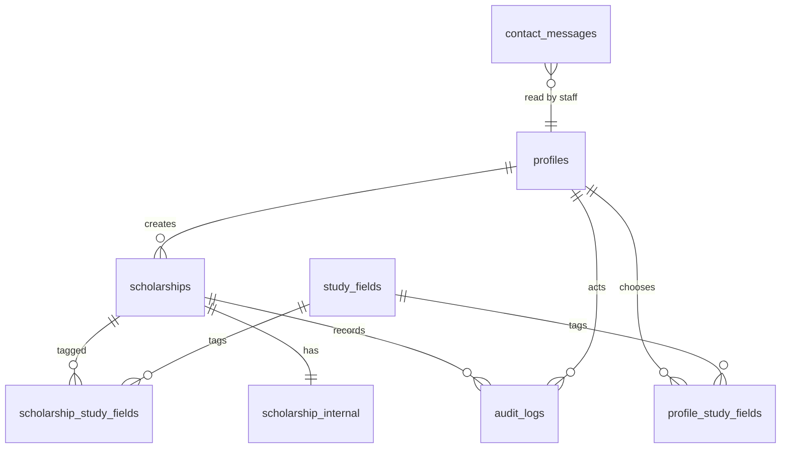
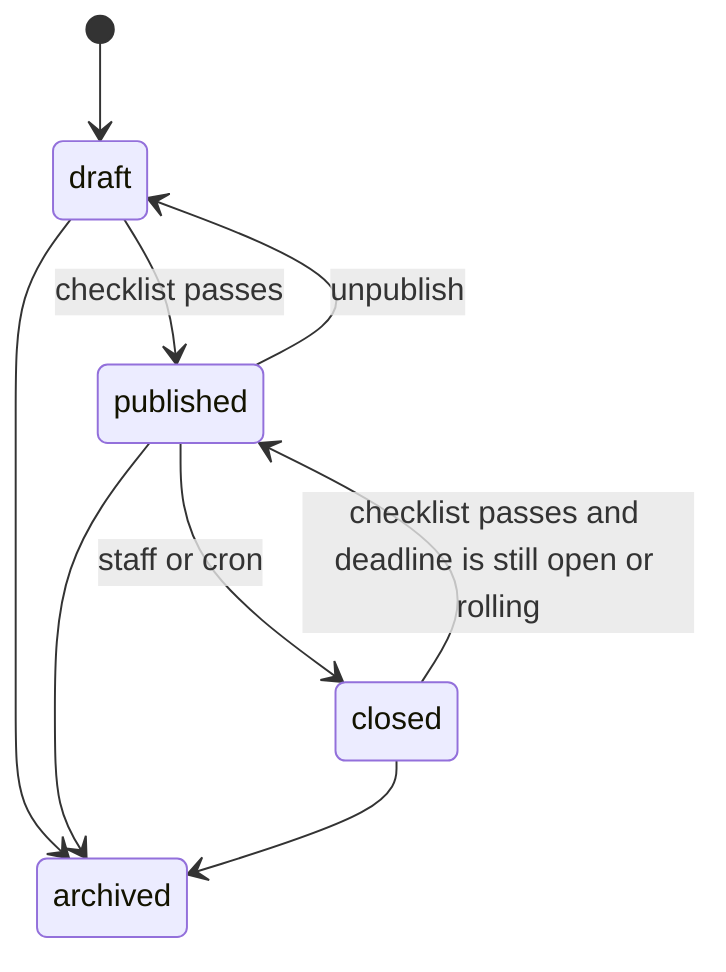

# Data model

The draft database contract is [proposed-schema.sql](proposed-schema.sql). This document explains the entities and the rules. During implementation, the first migration should be produced from that SQL, and later changes should be new migrations.

Identifiers are UUIDs. Timestamps are `timestamptz` in UTC. Country codes are ISO 3166-1 alpha-2. Currencies are ISO 4217. Timezones are IANA names, for example `Africa/Nairobi` or `Europe/London`.

## Entity overview



`contact_messages` does not require a profile. The relationship in the diagram is the staff member who marks it read, stored as a nullable `handled_by`.

## Profiles

One row per invited or promoted account. The auth trigger creates it when `app_metadata.role` is a known role. An auth user with no role gets no profile and cannot use the app. The break-glass super admin is inserted by the operator script.

| Column | Notes |
| --- | --- |
| `id` | Same UUID as `auth.users.id` |
| `role` | `super_admin`, `admin`, or `student` |
| `status` | `invited`, `active`, or `suspended` |
| `full_name` | Required. Collected on the invite form |
| `country_code` | Optional. The person sets it later |
| `education_level` | Optional interest, not a verified credential |
| `invited_by` | Super admin who sent the invite. Null for the break-glass first account |
| `created_at`, `updated_at` | |

Study interests are rows in `profile_study_fields`, not a free-text list, so they use the same vocabulary as listings.

Email lives in `auth.users`. The admin directory reads it through the server. It is copied onto nothing that a student can query about someone else.

A profile cannot change its own `role`, `status` (except `invited` to `active`), or `invited_by`. A trigger enforces that. The active transition happens when the invitee finishes setting a password.

## Study fields

A seeded lookup table: `id` (stable slug), `name`, `sort_order`, `active`.

Seed values: Agriculture, Architecture, Arts and design, Business, Computer science, Education, Engineering, Environmental studies, Health sciences, Humanities, Law, Mathematics, Medicine, Natural sciences, Social sciences, Vocational, Other.

Deactivate a field instead of deleting it if listings still point at it. Adding a field is a small migration or, later, an admin screen. V1 can ship the seed and add rows with a migration when the editorial team needs a new one.

## Scholarships

| Column | Notes |
| --- | --- |
| `slug` | Lowercase hyphenated. Unique. Null while a draft has no title yet. Locked in application code after first publish |
| `title` | |
| `summary` | Required to publish. 40–280 characters at publish time |
| `description_markdown` | What the program is |
| `eligibility_markdown` | Who can apply, in prose |
| `benefits_markdown` | What is covered, in prose |
| `required_documents` | Text list shown publicly and reused later by an application form |
| `provider_name` | |
| `provider_url` | Official site, `https` |
| `application_url` | Optional `https` link |
| `application_mode` | `external` or `coming_soon` |
| `status` | `draft`, `published`, `closed`, `archived` |
| `is_featured` | Only while published. Cleared automatically when the listing leaves `published` |
| `is_sponsored` | Default false. When true, `sponsor_disclosure` is required |
| `sponsor_disclosure` | Sentence shown on the page next to the Sponsored label |
| `study_levels` | One or more of `secondary`, `certificate`, `diploma`, `bachelor`, `master`, `doctorate`, `postdoctoral` |
| `funding_type` | `full`, `partial`, `tuition`, `stipend`, `other`. Required to publish |
| `amount_min`, `amount_max` | Nullable, non-negative, min ≤ max when both exist |
| `currency` | Required when either amount exists |
| `funding_notes` | Short text, for “tuition only” or “amount varies by campus” |
| `host_country_code` | Nullable |
| `is_remote` | True when the student does not relocate. A program can be remote and still name a host country |
| `delivery_mode` | `on_campus`, `online`, or `hybrid` |
| `open_to_all_nationalities` | Boolean |
| `eligible_country_codes` | Array of alpha-2 codes |
| `deadline_at` | Nullable |
| `deadline_timezone` | IANA. Required when `deadline_at` is set |
| `is_rolling` | When true, a null deadline is valid |
| `cover_image_path` | Storage path, nullable |
| `seo_title`, `seo_description` | Optional overrides |
| `published_at`, `closed_at` | Set by the status trigger |
| `last_verified_at` | Shown publicly as “Information checked on …” |
| `review_due_at` | `last_verified_at + 90 days`. The admin queue uses this |
| `created_by`, `updated_by` | Set null if that profile is deleted |
| `search_vector` | Generated from title, summary, provider, and description |

### Nationality meaning

| `open_to_all_nationalities` | `eligible_country_codes` | Public meaning |
| --- | --- | --- |
| true | ignored | Open to all nationalities |
| false | one or more codes | Restricted to those nationalities |
| false | empty | Not specified |

The third state is allowed in the database because real announcements omit it. The UI must not render it as “open to all”.

### Deadline meaning

A listing is either rolling or it has a deadline and a timezone. The publish trigger rejects a non-rolling listing without both. Display uses the stored timezone and the viewer’s local zone.

`review_due_at` is a generated stored column.

### Status



The trigger rejects any other jump. Archiving is terminal in v1. Restoring an archive means a new listing, which keeps public history simple.

Unpublish returns a listing to draft and clears `is_featured`. It keeps `published_at` so the next publish can show the original date, and the action updates `published_at` if you would rather treat republish as a new publication. Build baseline: set `published_at` to `now()` whenever the status becomes `published`.

Closing sets `closed_at` and clears `is_featured`.

### Publish checklist

All of these must be true before status can become `published`:

- Slug, title, and summary (40–280 characters) present
- Description present
- Provider name and `https` provider URL present
- Application mode set. If mode is `external`, an `https` application URL is present
- At least one study level and one study field
- Funding type set. If an amount is set, currency is set
- Rolling, or both deadline and timezone
- `scholarship_internal.upfront_fee_absent_confirmed` is true
- `last_verified_at` is set
- Sponsored listings have a disclosure

The editor sets `last_verified_at` to the current time when the staff member checks “I verified this against the provider’s materials today”.

## Scholarship internal

One private row per listing. RLS allows active staff only. The public query never selects this table.

| Column | Notes |
| --- | --- |
| `scholarship_id` | Primary key and foreign key |
| `source_notes` | Where the facts came from: announcement URL, brochure, phone call |
| `editorial_notes` | Anything the next editor should know |
| `upfront_fee_absent_confirmed` | Required at publish |
| `verified_by` | Profile id of the last person who confirmed the checklist |

## Audit log

Append-only. Super admins can read it. Students and admins cannot. Updates and deletes are not granted.

| Column | Notes |
| --- | --- |
| `actor_id` | Null for cron and for deleted users |
| `action` | Dot-separated name, listed below |
| `entity_type` | `scholarship`, `profile`, `contact_message` |
| `entity_id` | |
| `metadata` | Small JSON. Changed field names and the new status. Not the full markdown body, not a copy of a contact message |
| `created_at` | |

Actions:

- `scholarship.created`, `scholarship.updated`, `scholarship.published`, `scholarship.unpublished`, `scholarship.closed`, `scholarship.archived`
- `user.invited`, `user.suspended`, `user.reactivated`, `user.role_changed`, `user.deleted`
- `contact.read`, `contact.closed`

Scholarship rows are written by a trigger so a direct database change is still recorded. User-admin actions are written by the server route because the actor is the super admin, while the auth trigger only sees the new user. Profile role and status changes are also trigger-logged when they happen outside that route.

Retention baseline is 24 months, then a scheduled delete. See [D-36](07-gaps-and-decisions.md).

## Contact messages

| Column | Notes |
| --- | --- |
| `name`, `email`, `reason`, `message` | From the form |
| `status` | `new`, `read`, `closed` |
| `handled_by`, `read_at` | Set when a staff member opens it |
| `created_at` | |

No raw IP address. Abuse control uses `rate_limit_buckets`:

| Column | Notes |
| --- | --- |
| `bucket_key` | `sha256(pepper + ip + 'contact')` stored as text |
| `window_start` | |
| `hit_count` | |

A daily cron deletes buckets older than 48 hours. The pepper is `RATE_LIMIT_PEPPER`.

RLS: staff can select and update contact messages. Inserts happen with the service role only, so the public API cannot be used as an open relay.

## Indexing

- Unique index on `scholarships.slug` where slug is not null
- GIN index on `search_vector`
- Index on `(status, deadline_at)` for the catalog and the cron
- Index on `(status, review_due_at)` for the stale queue
- Index on `is_featured` where status is published

## Storage

| Bucket | Public | Contents in v1 |
| --- | --- | --- |
| `scholarship-media` | Public read | Cover images only |

Staff write. Anyone can read. Objects are not access-controlled per listing, so the bucket must not contain personal documents.

## Future application model

These tables are not created in v1. They are specified so current columns stay compatible.

```text
applications
  id
  scholarship_id      -> scholarships.id
  student_id          -> profiles.id
  status              draft | submitted | withdrawn | unsuccessful | awarded
  submitted_at
  payload             jsonb validated by a per-scholarship or shared zod schema
  created_at, updated_at
  unique (scholarship_id, student_id)

application_files
  id
  application_id
  storage_path        private bucket application-files
  original_filename
  content_type
  byte_size
  created_at
```

What v1 does now so this fits later:

- `required_documents` is already a list the form can turn into upload slots
- `application_mode` gains a third value `in_app` in a later migration, without renaming `external`
- Eligibility prose and structured nationality, level, and field filters are already stored
- Student profiles already exist and are invite-based, so an application has a real `student_id`
- Cover images and application files use different buckets

Phase 3 still has to design: which statuses the provider versus the staff can see, whether this organization is an application processor or only a form in front of email, retention of rejected files, malware scanning, and how a student withdraws. Those are product decisions, not schema accidents. See [D-25](07-gaps-and-decisions.md) and [D-26](07-gaps-and-decisions.md).

## Annual cycles

A listing that repeats next year should be updated in place when it is the same program: new deadline, new verification date, status back to published. The slug stays. If the provider treats it as a different program, staff create a new listing and archive the old one.

There is no season entity in v1. See [D-32](07-gaps-and-decisions.md).

## Seeds

- Study fields, as listed above
- No sample scholarships in production
- Dev and preview get a handful of published, draft, and closed fixtures so layout and filters can be tested
- The first super admin is created by the break-glass procedure in [05-auth-and-authorization.md](05-auth-and-authorization.md), not by the seed file
